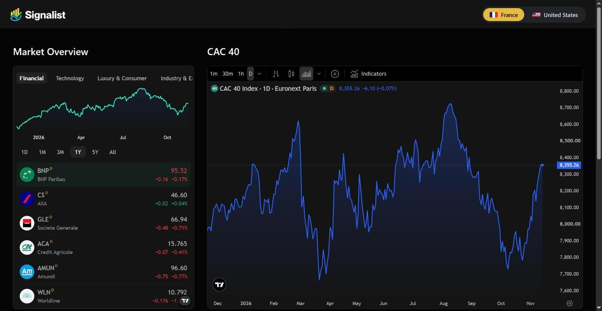
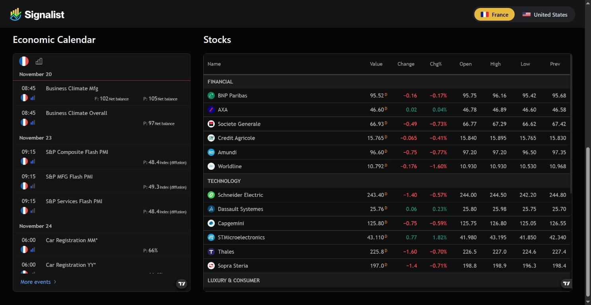
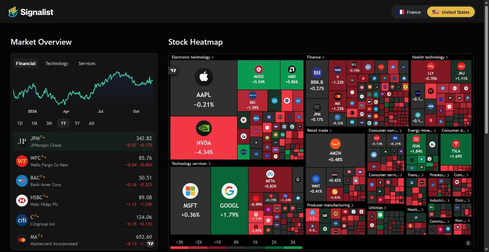

# Signalist — Stock Market Dashboard

**French and US markets at a glance.**

A dark, real-time stock dashboard built on TradingView widgets. Flip between the Paris and US markets with one switch and get live quotes, charts and the market's pulse on a single page.



| France: calendar and stocks | United States |
| --- | --- |
|  |  |

## Features

- **Market switch**: France (default) or United States, kept in the URL (`?market=us`) so a view can be shared
- **France**: 23 Euronext Paris companies across Financial, Technology, Luxury & Consumer and Industry & Energy, a one-year CAC 40 chart and the French economic calendar
- **United States**: major NYSE and Nasdaq names, an S&P 500 heatmap by sector and the latest market stories
- **Live quotes table**: price, change, open, high, low and previous close for every company
- **No sign-up**: everything is public, with no account or API key needed

TradingView's heatmap and news widgets have no usable French data, so France gets the CAC 40 chart and the economic calendar in those slots.

## Tech stack

Next.js 15 (App Router) · React 19 · TypeScript · Tailwind CSS v4 · TradingView widgets

## Getting started

```bash
npm install
npm run dev
```

Open [http://localhost:3000](http://localhost:3000). Companies and widget settings for both markets live in `lib/constants.ts`.

| Command | Description |
| --- | --- |
| `npm run dev` | Start the dev server |
| `npm run build` | Production build |
| `npm run start` | Serve the production build |
| `npm run lint` | Lint the project |
